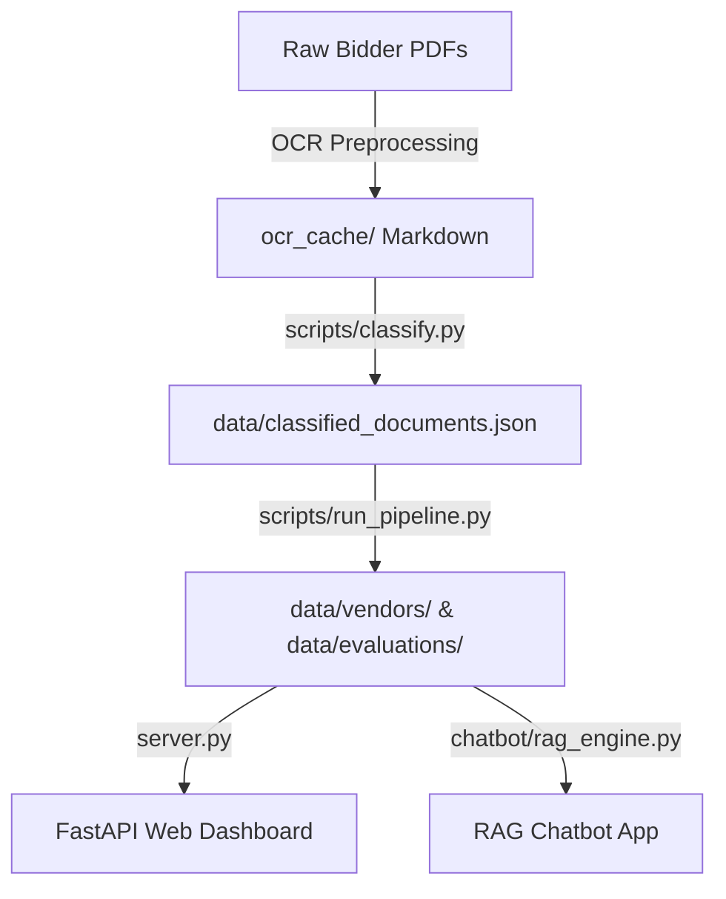

# IOCL GeM Tender Evaluation Pipeline: System Overview

This document provides a comprehensive overview of the **IOCL GeM Tender Evaluation Pipeline**, summarizing the system architecture, folder structure, core objectives, and implementation stack.

---

## 1. Project Objectives & Goals

The system automates and assists in the audit and evaluation of commercial bids submitted by vendors for an Indian Oil Corporation Limited (IOCL) Government e-Marketplace (GeM) tender (specifically for **ARC Cartridges**). 

The primary objectives are:
1. **Document Classification & Segmentation:** Automatically identify and split merged multi-page bid PDFs into discrete document types (e.g., PAN Cards, GST Certificates, Udyam Registrations, Purchase Orders, Invoices).
2. **Structured Data Extraction:** Extract relevant metadata (e.g., PO numbers, issuing organizations, values, dates, and item descriptions) from bidder submissions.
3. **Pre-Qualification Criteria (PQC) Evaluation:** Evaluate bidder compliance against complex technical PQC rules (Option A, B, or C) and determine eligibility:
   * **Option A:** Three similar orders, each costing at least **₹1,51,500**.
   * **Option B:** Two similar orders, each costing at least **₹2,02,000**.
   * **Option C:** One similar order costing at least **₹3,03,000**.
   * **MSE / Startup Exemption:** Automatic exemption check based on enterprise classifications.
4. **Human-in-the-Loop Verification:** Provide an audit dashboard for human verification, layout coordinate visualization (bounding boxes on PDF page renders), and manual correction feedback.

---

## 2. System Architecture & Components

The system is split into three main layers: the **Pipeline Layer**, the **Serving/Web Layer**, and the **RAG Chatbot Layer**.



### A. The Processing Pipeline (pipeline/)
* **OCR Preprocessing (`vlm_engine.py`):** Converts PDFs to page-by-page images and performs layout-aware OCR text extraction using `qwen2.5vl:3b` or Gemini API fallbacks, caching outputs.
* **Document Classifier (`doc_classifier.py`):** Segments documents purely through LLM prompts, identifying start/end pages and document classifications.
* **Data Extractor (`data_extractor.py`):** Leverages LLMs to extract Pydantic structured data (like dates and values), parses currencies, and uses PyMuPDF (`fitz`) to map extracted fields to bounding box coordinates on the PDF pages.
* **PQC Evaluator (`pqc_evaluator.py`):** Evaluates extracted data against the tender's qualification criteria rules.

### B. The FastAPI Web Application (server.py)
* Serves the dark-mode **Step-by-Step Review UI** at `http://localhost:8001/review`.
* Handles page rendering dynamically on the fly from raw PDFs using PyMuPDF.
* Exposes endpoints to run the evaluation pipeline, fetch bidder documents, and save inline user-annotated comments to `data/user_feedback.json`.

### C. Chatbot Engine (chatbot/)
* **Knowledge Graph (`knowledge_graph.py`):** Maps vendor relationships, evaluations, and criteria matches in a NetworkX graph structure for structured queries.
* **Vector Store (`vector_store.py`):** Chunks and indexes extracted text data in ChromaDB using `nomic-embed-text` embeddings for semantic search queries.
* **RAG Engine (`rag_engine.py`):** Directs incoming user queries (Structured vs. Semantic vs. Hybrid) and responds using the LLM with relevant citations.

---

## 3. Directory Layout

Following our cleanup and refactoring, the repository is structured as follows:

```
.
├── raw_bids/                 # Original PDF files submitted by bidders (no spaces in paths)
│   └── ARC Cartridges_Bids/
│       ├── ARMS PERIPHERALS/
│       ├── FOUNTAIN STATIONERS/
│       └── ...
├── ocr_cache/                # Cached OCR markdown outputs per bidder document
├── data/                     # Output evaluation results, extractions, and user logs
│   ├── evaluations/          # PQC evaluation criteria JSON outputs
│   ├── vendors/              # Structured vendor entity extraction JSON outputs
│   ├── page_images/          # Cached page images rendered dynamically for dashboard viewing
│   ├── temp_ocr_images/      # Temporary images created during OCR processing
│   ├── classified_documents.json # Document registry classifications
│   └── user_feedback.json    # Evaluator feedback comments
├── config/                   # Configuration parameters
│   └── tender_config.json    # Thresholds, target items, dates, and LLM models
├── pipeline/                 # Core Python Library Package (ONLY modular logic)
│   ├── models.py             # Pydantic data schemas
│   ├── llm_router.py         # Unified LLM API router (Gemini -> OpenRouter -> Ollama)
│   ├── doc_classifier.py     # Classification logic
│   ├── data_extractor.py     # Entity extraction logic
│   ├── pqc_evaluator.py      # PQC rules checking
│   └── vlm_engine.py        # OCR runner
├── scripts/                  # Clean CLI runner scripts (Import from pipeline/)
│   ├── classify.py           # Runs batch document classification
│   ├── run_pipeline.py       # Runs entity extraction and PQC evaluation
│   ├── run_ocr_batch.py      # Performs batch OCR generation
│   └── test_ground_truth.py  # Standard verification test script
├── playground/               # Local test playground (Not used in production)
│   ├── count_pdf_pages.py
│   └── test_gemini.py
├── dashboard/                # Web dashboard static HTML/CSS/JS resources
│   └── review.html           # Dark-mode review SPA
├── tests/                    # Unit testing suite
│   └── test_pqc_evaluator.py
├── server.py                 # FastAPI web application entrypoint
└── requirements.txt          # System requirements
```

---

## 4. LLM Fallback & Router Design

To bypass API limits and handle rate limits robustly, all core pipeline components make calls through a unified router (`llm_router.py`):

1. **Primary: Gemini API (`google-genai`)**
   * Uses Gemini-2.5 Flash for high-speed, structural data extraction and classification.
2. **Fallback 1: OpenRouter API**
   * Invoked if Gemini returns `RESOURCE_EXHAUSTED` (429 rate limit exceptions) or credential issues.
3. **Fallback 2: Local Ollama Client**
   * Runs local models (like `llama3:8b` or `gpt-oss:20b`) if network connection fails or API keys are unavailable, guaranteeing completion of batch processing offline.

---

## 5. Work Completion Proof Validation Rule

The evaluation engine enforces the following critical validation rule:
* **Rule**: A **GeM Contract** (such as a GeM Purchase Order or `GEM_BID_COPY`) only signifies that an order was placed, but does **not** serve as proof of work completion/execution.
* **Valid Proofs of Completion**:
  1. An **Invoice** (`INVOICE`)
  2. A **Bank Certificate** indicating payment receipt
  3. An **Execution Certificate** (`EXECUTION_PROOF`) indicating the final executed value
  4. A **previous IOCL work document** (e.g. internal completion record)
