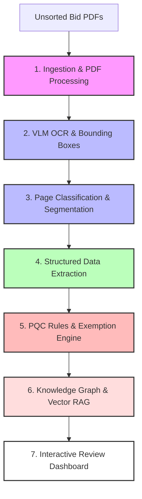

# Procura: Technical Architecture & Pipeline Report
An Enterprise-Grade, Layout-Aware AI System for Automated Commercial Bid Evaluation

---

## 1. Executive Summary & Core Concept

In public procurement, verifying bidder compliance is one of the most resource-intensive steps. Bidders submit folders containing hundreds of pages of unorganized PDF documents, including Udyam Registrations, PAN cards, GST certificates, Manufacturer Authorization Forms (MAFs), past Purchase Orders (POs), and Invoices/Completion certificates. 

Evaluating compliance against **Pre-Qualification Criteria (PQC)** manually takes hours to days per bidder, is prone to human bias, and lacks clear audit trails.

**Procura** solves this by automating the entire commercial evaluation workflow. It digests bid folders, extracts critical metadata with pixel-perfect document coordinates, checks vendor eligibility against multi-option PQC policies (e.g., experience values and dates), matches orders to proof-of-execution documents, and generates a fully traceable visual dashboard and a RAG (Retrieval-Augmented Generation) query system.

---

## 2. High-Level Architecture

The system processes raw PDF bids in a sequential pipeline, mapping unstructured inputs to a structured JSON database, a graph network, and a vector search index.



---

## 3. Deep-Dive: The Processing Pipeline

The processing pipeline runs in distinct stages to minimize GPU load and maximize execution speed:

### Step 1: Ingestion & Text Extraction ([`pdf_processor.py`](file:///Users/viswarup/Downloads/tender%20evaluation/pipeline/pdf_processor.py))
1. **Dynamic Native Extraction**: The system parses the PDF using `pypdf`. If the page contains native digital text (at least 30 characters), it extracts it directly.
2. **On-Demand Rendering**: If the page has no extractable text (meaning it is a scanned image), it marks it for OCR. PyMuPDF (`fitz`) renders only these specific pages as PNG images. This **lazy-rendering** approach saves massive processing time and storage compared to rendering entire documents.

### Step 2: VLM-Based OCR & Coordinate-Mapping ([`vlm_engine.py`](file:///Users/viswarup/Downloads/tender%20evaluation/pipeline/vlm_engine.py))
For scanned or image-based pages, the system sends the page images to a local Vision-Language Model (VLM):
* **Primary VLM**: `qwen2.5vl:3b` running on Ollama.
* **Fast Mode**: Used by default to retrieve plain text quickly (3-5x faster) without layout metadata.
* **Full Mode**: Retrieves both text and bounding box locations. The VLM outputs a structured JSON object containing text blocks with their coordinates normalized as percentages: `[x_min, y_min, x_max, y_max]`.
* **Caching Layer**: Results are written to a localized cache file (`data/ocr_cache.json`) to guarantee that identical pages are never processed twice.

### Step 3: Document Segmentation & Multi-Page Classification ([`doc_classifier.py`](file:///Users/viswarup/Downloads/tender%20evaluation/pipeline/doc_classifier.py))
Bidders often merge all their documents (e.g., Udyam certificate + 3 separate Purchase Orders + Invoices) into a single, massive PDF file.
1. **Page Snippets**: The system extracts the headers and footers (first 400 and last 300 characters) of each page.
2. **LLM Segmentation**: The router sends the snippets to `llama3:8b` to split the document into logical boundaries.
3. **Segment Mapping**: The LLM classifies page ranges into logical files (e.g., Pages 1-3 = `UDYAM_MSME`, Pages 4-8 = `PURCHASE_ORDER`, Page 9 = `INVOICE`).

### Step 4: Structured Data Extraction ([`data_extractor.py`](file:///Users/viswarup/Downloads/tender%20evaluation/pipeline/data_extractor.py))
For each classified document segment, the system runs domain-specific extractions using `gpt-oss:20b`:
* **GeM Contract POs**: High-speed regex heuristics match standard patterns (such as `GEMC-` contract numbers and pricing tables) instantly without querying the LLM.
* **Non-GeM POs**: The LLM extracts the PO Number, Issuing Organization, Date, and Order Value.
* **CA Certificates / Udyam / GST**: The LLM extracts CA names, enterprise types (Micro/Small/Medium), major activity, and registration details.
* **Monetary Normalization**: A parser converts strings containing currency symbols, commas, and Indian numbering formats (Lakhs/Crores) into standard float numbers (INR).
* **Coordinate Mapping**: The system searches for the exact text of extracted values in the PDF to determine their coordinate boundaries, populating `SourceReference` models.

### Step 5: PQC Rules & Exemption Engine ([`pqc_evaluator.py`](file:///Users/viswarup/Downloads/tender%20evaluation/pipeline/pqc_evaluator.py))
The engine compares the extracted metadata against the PQC criteria defined in [`config/tender_config.json`](file:///Users/viswarup/Downloads/tender%20evaluation/config/tender_config.json):
1. **Commercial Value Checks**: Compares PO values against three options (e.g., Option A: 3 orders of ₹1.82L; Option B: 2 orders of ₹2.43L; Option C: 1 order of ₹3.03L).
2. **Similar Item Similarity Check**: Validates the description of items ordered (e.g., checks if the past order was for "Supply of toners or cartridges"). It uses a keyword checklist first, falling back to a structured LLM similarity check prompt for ambiguous items.
3. **Exemptions Check**:
   * **MSE (Micro & Small Enterprises) Exemption**: If Udyam data indicates the vendor is a Micro or Small enterprise.
   * **Startup Exemption**: Scans documents for DPIIT registration text.
   * If exempted, the engine relaxes or waives the experience and monetary requirements.

### Step 6: Work Completion Proof Cross-Referencing
> [!IMPORTANT]
> **Audit Rule**: A GeM contract or Purchase Order is **NOT** proof of work completion.
* To prevent fraud and ensure strict commercial compliance, the system cross-references each Purchase Order against Invoices (`INVOICE`) and client execution certificates (`EXECUTION_PROOF`).
* If a matching PO number is found in a completion proof or self-certified invoice, the status is set to `SUBMITTED`. If no matching proof is found, the PO's execution status is flagged as `NOT_SUBMITTED`, marking the vendor as `QUERIED` or `REJECTED`.

### Step 7: Knowledge Graph & Hybrid RAG System ([`chatbot/`](file:///Users/viswarup/Downloads/tender%20evaluation/chatbot/))
To allow auditors to query the evaluation results naturally, the system indexes the pipeline outputs into two databases:
1. **Knowledge Graph (NetworkX)**: Models the relations between vendors, documents, POs, values, and audit outcomes. This handles structured questions perfectly (e.g., *"Which vendors are accepted under Option B?"* or *"List all POs above 2 Lakhs"*).
2. **Vector Store (ChromaDB + `nomic-embed-text`)**: Indexes chunked document text for semantic lookup (e.g., *"Find Kyocera authorization letters"*).
3. **Hybrid Router**: Routes questions to the Graph, Vector DB, or a combined ("Hybrid") context, feeding the aggregated details to the chatbot model (`gpt-oss:20b`).

### Step 8: Interactive Audit Dashboard & Web API ([`server.py`](file:///Users/viswarup/Downloads/tender%20evaluation/server.py))
A FastAPI web server hosts the API layer:
* **Traceability Mappings**: Binds frontend actions to file resources. Clicking on an extracted value sends its page number and bounding box coordinates to the viewer.
* **Layout Renderings**: Serves page images on demand.
* **Security & Auth**: hardens endpoints against unauthorized calls using API key checking (`X-API-Key` headers or `?api_key=` queries).

---

## 4. Models and Infrastructure Registry

The system is configured to prioritize local processing for maximum data sovereignty, but it dynamically falls back to cloud APIs when needed.

| Model / Service | Backend Port / Platform | Purpose in System | Configuration File Location |
| :--- | :--- | :--- | :--- |
| **`qwen2.5vl:3b`** | Ollama (Local) | VLM OCR & Bounding Box Coordinates | `ocr_vision` config |
| **`llama3:8b`** | Ollama (Local) | Page-by-page document classification | `classifier` config |
| **`gpt-oss:20b`** | Ollama (Local) | Metadata extraction & rules check | `extractor`/`evaluator` config |
| **`nomic-embed-text`** | Ollama (Local) | ChromaDB text embeddings | `embeddings` config |
| **`gemini-2.5-flash`** | Google Cloud API | Primary Cloud Fallback (OCR & LLM) | Centralized router fallback |
| **`llama-3.3-70b`** | OpenRouter API | Secondary Cloud Fallback (LLM queries) | Centralized router fallback |

### Centralized Router Fallback Chain ([`pipeline/llm_router.py`](file:///Users/viswarup/Downloads/tender%20evaluation/pipeline/llm_router.py))
Every time the system calls an LLM, it routes through a centralized resilience chain:
1. **Google Gemini API**: Uses `gemini-2.5-flash` (or `gemini-1.5-flash`) if `GEMINI_API_KEY` is present.
2. **OpenRouter API**: Falls back to `google/gemini-2.5-flash` or free OpenRouter models if Gemini fails.
3. **Ollama**: Falls back to the local models (`gpt-oss:20b`, `llama3:8b`) if cloud APIs fail.

---

## 5. Security & UI Layout Hardening

The codebase includes several layers of production hardening:

1. **Path Traversal Shielding**: FastAPI endpoints validate that file paths requested by the frontend are strictly within the designated workspace/data directories.
2. **XSS Mitigation**: The JavaScript frontend utilizes a helper function (`escapeHtml()`) to strip out HTML tags from VLM/LLM string outputs, preventing malicious scripts embedded in document text from executing.
3. **API Key Authorization**: Requests require an `X-API-Key` header. To accommodate HTML elements (like `` tags that do not support custom request headers natively), the API key validation function in `server.py` checks both headers and URL query parameters.
4. **Viewport CSS Layout Fixed**: Resolved a scroll lock bug in Step 3 of the review dashboard where the sidebar containing document details would not scroll. By constraining the parent layout using `height: 100vh` rather than `min-height: 100vh`, the sidebar scroll panels trigger correctly.

## 6. System Accuracy Evaluation Framework

To evaluate and guarantee the accuracy of Procura in production, audits can be performed at several key checkpoints in the pipeline. Below is the framework outlining where evaluations are conducted and what ground-truth data is required for each.

### 6.1 Evaluation Checkpoints

| Checkpoint | Target Metric | Metric Definition | Impact of Error |
| :--- | :--- | :--- | :--- |
| **1. OCR & VLM Text Extraction** | Character Error Rate (CER) & Word Error Rate (WER) | Measures the percentage of insertion, deletion, and substitution errors in the transcribed text compared to manual transcription. | Fails downstream keyword matching or LLM metadata parsing. |
| **2. Document Classification & Segmentation** | Page Classification F1-Score & Segment IoU | Measures if pages are mapped to the correct document type (e.g. GST, PO) and if segments are split correctly. | Merged documents are misclassified or PO ranges are truncated, leading to skipped extractions. |
| **3. Structured Metadata Extraction** | Exact Match (EM) & Relative Numeric Error | Checks if fields (PO numbers, Udyam trade names, GSTINs, PO dates, monetary values) are extracted and parsed correctly. | Wrong PO values or dates lead to incorrect PQC pass/fail decisions. |
| **4. PQC Evaluation Rules Engine** | Classification Accuracy & Decision Matrix | Evaluates the system's final decisions (ACCEPTED, REJECTED, QUERIED) against human auditor consensus. | False Acceptances (compliance risk) or False Rejections (unfair vendor disqualification). |
| **5. Traceability Bounding Box Hit Rate** | Bounding Box Intersection-over-Union (IoU) | Verifies if the highlighted coordinate box in the document viewer covers the target text block. | Poor UX; highlights blank space or wrong sections when users audit a value. |
| **6. Chatbot hybrid RAG System** | Groundedness, Answer Relevance, and Retrieval Precision | Evaluates if answers are grounded in context, retrieve the correct documents, and contain no hallucinated claims. | Evaluators get inaccurate advice or references during auditing queries. |

### 6.2 Ground-Truth Data Requirements

Running these evaluations requires establishing a curated **Ground-Truth Dataset (Gold Standard)**. The table below lists the datasets and schemas needed:

| Evaluation Checkpoint | Required Ground-Truth Data | Schema / Format Example |
| :--- | :--- | :--- |
| **OCR & Text Extraction** | A set of 50-100 representative scanned and digital PDF pages, paired with manually double-verified text files. | A folder of `.png` page images and matching `.txt` manual transcription files. |
| **Document Classification** | Page-level labels for vendor PDF packages showing the document segment type and range. | JSON map:<br>`{ "doc_1.pdf": [{"start": 1, "end": 4, "type": "PURCHASE_ORDER"}, {"start": 5, "end": 5, "type": "INVOICE"}] }` |
| **Structured Extraction** | A key-value manifest containing the correct metadata values for each extracted file. | JSON file:<br>`{ "po_1.pdf": { "po_number": "GEMC-5116", "po_value_numeric": 310000.0, "po_date": "2024-06-15" } }` |
| **PQC Decisions** | The master evaluation PQC matrix (e.g. `pqc1.pdf` ground-truth) detailing vendor statuses and reasons. | Structured table or Excel sheet detailing the final status, met option, and exemptions for all test vendors. |
| **Traceability Bounding Box** | Manually marked bounding boxes for critical metadata fields. | Coordinate ranges in JSON:<br>`{ "po_number": { "page": 1, "bbox": [10.2, 15.5, 45.1, 18.2] } }` |
| **Chatbot hybrid RAG** | A test suite of 50 common auditor questions, matched with reference answers and valid source citations. | JSON list:<br>`[ { "question": "Why is Fountain Stationers queried?", "answer": "Fountain Stationers is queried because PO GEMC-51168 is pending execution proof.", "sources": ["FOUNTAIN STATIONERS:doc_1.pdf:p4"] } ]` |

---

## 7. How to Run and Interact

### Running the Evaluation Pipeline
Run the orchestrator script to process a vendor's folder:
```bash
PYTHONPATH=. ./.venv/bin/python3 scripts/run_pipeline.py --vendor "HEAMONS SYSTEMS"
```

### Spinning up the API Server & Dashboard
Launch the FastAPI server (running on port `8000` by default):
```bash
PYTHONPATH=. ./.venv/bin/python3 server.py
```
Open [http://localhost:8000](http://localhost:8000) in your browser to view the interactive dashboard, browse the visual bounding boxes, and chat with the RAG evaluation assistant.
